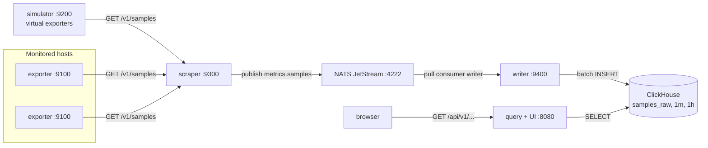

# FleetPulse

FleetPulse monitors a fleet of hosts. An **exporter** runs on every host and samples seven sensors once per second. A **scraper** pulls exporters and publishes each scrape to NATS JetStream. A **writer** batch-inserts the messages into ClickHouse. A **query** service serves an HTTP API and a single-page web UI. A **simulator** can stand in for the whole fleet. `backfill`, `smoketest` and `loadtest` cover history, verification and capacity.

Every component is a Go binary. The local stack runs with `docker compose up -d`.

## Quickstart (5 minutes)

### Requirements

- Docker Engine 24 or newer with Compose v2, or Docker Desktop.
- About 4 GB of RAM free and a few GB of disk free for images and volumes.
- Ports `8080`, `8123`, `9000`, `9200`, `9300`, `9400`, `4222` and `8222` free.

### Start the stack

Clone the repository and change into its root, then:

```sh
docker compose up -d
```

The first start builds five Go images from `build/Dockerfile` and takes a few minutes. ClickHouse applies `deploy/clickhouse/init/001_schema.sql` on its first start. The one-shot `seed` container writes simulated history.

### Check that it works

```sh
docker compose ps -a
curl -s localhost:8080/readyz
curl -s 'localhost:8080/api/v1/series?devices=sim-00001&sensors=cpu_usage&range=5m'
```

Expected results:

- `docker compose ps -a` shows `clickhouse` as `healthy`, `seed` as `Exited (0)`, and the other services as `Up`.
- `/readyz` prints `ok`.
- The series request returns a JSON object with a `series` array. `points` are `[timestamp, avg, min, max]` rows. Live points appear within about a minute of startup; seeded history is there immediately.

### Open the UI

Open <http://localhost:8080>. Type `sim` in the device search, select `sim-00001`, and pick a range. `5m`, `15m`, `1h`, `6h`, `24h` and `7d` have data after the first start. `30d`, `90d` and `1y` initially show only the seeded 14 days; run the one-year backfill to fill them:

```sh
make backfill-year
```

### Stop

```sh
make down     # stop containers, keep NATS and ClickHouse data
make reset    # stop containers and delete the volumes
```

## Architecture



Data moves in one direction: exporters hold a 300-second buffer, the scraper keeps a cursor per target, NATS keeps a 48-hour replay buffer, and the writer acknowledges a message only after ClickHouse accepted the insert. See [Architecture](docs/architecture.md) for the failure behaviour of each hop.

## Documentation

| page | contents |
|------|----------|
| [Quickstart](docs/quickstart.md) | prerequisites, health checks, scaling the fleet, first problems |
| [Architecture](docs/architecture.md) | data flow, service responsibilities, what happens when a component is down |
| [Configuration](docs/configuration.md) | every environment variable and flag |
| [API](docs/api.md) | exporter API, query API, simulator admin API, telemetry |
| [Operations](docs/operations.md) | daily checks, health signals, backup and restore, upgrades, retention |
| [Troubleshooting](docs/troubleshooting.md) | symptom, cause and fix for common failures |
| [Development](docs/development.md) | layout, how to add a sensor end to end, integration tests |
| [Storage](docs/storage.md) | ClickHouse schema, tiers, TTLs, useful SQL |
| [Sensors](docs/sensors.md) | what each sensor measures and its platform limits |
| [Simulator](docs/simulator.md) | virtual fleet API and signal model |
| [Backfill](docs/backfill.md) | how history is generated and written |
| [Testing](docs/testing.md) | unit tests, smoke test, chaos checks |
| [Design](docs/design.md) | decisions, capacity, growth, migration and operations |
| [AI usage](docs/ai-usage.md) | where AI helped and what was rejected |
| [Load-test results](docs/loadtest/results/2026-11-15-8gb-laptop/report.md) | archived run, graphs and hardware |
| [Web UI](docs/ui.md) | UI behaviour and manual checklist |
| [Load test](docs/loadtest/README.md) | capacity test, graphs and diagnosis |
| [Exporter on Linux](docs/exporter/linux.md) | systemd install |
| [Exporter on macOS](docs/exporter/macos.md) | launchd install |
| [Exporter on Windows](docs/exporter/windows.md) | NSSM service install |
| [Architecture decision records](docs/architecture.md#architecture-decision-records) | why the stack is built this way |

## Repository layout

```text
cmd/            one main package per binary
internal/       business logic, one package per concern
web/            single-file UI source, vendored uPlot, embedded output
deploy/         ClickHouse schema, scraper config, exporter service files
contracts/      cross-component contracts; they are the source of truth
docs/           user and operator documentation
scripts/        build, smoke, loadtest, schema verification helpers
```

## Tests

```sh
make fmt lint test       # formatting, lint, unit tests with the race detector
make build               # compile every package
make smoke               # start the stack and run the end-to-end checks
```

`make test` needs Go only. `make smoke` needs Docker: it rebuilds and starts
the stack with a five-device fleet (`SMOKE_DEVICES`), runs `seed`, then runs the
checks. See [Development](docs/development.md) and [Testing](docs/testing.md).
