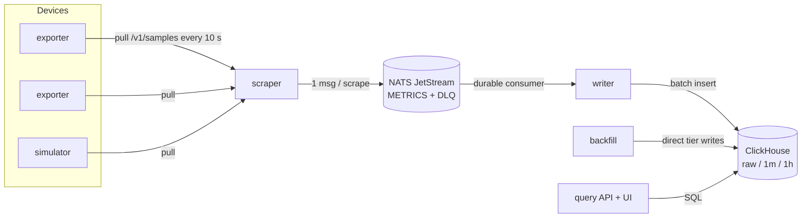

# Design

This document explains why FleetPulse is built the way it is and what would
change at a larger scale. It is written to be read without the author present.

**Numbers.** A number marked **MEASURED** comes from a named observation; the
source is stated with it. A number marked **ESTIMATE** is arithmetic on measured
values plus a stated assumption, and is never presented as a measurement. Where
a measurement does not exist yet, the text says **MEASURED: TBD**. Configuration
values (a 300-second buffer, a 90-day retention), SLO targets and the
10,000-device assumption are decisions from the contracts and the task, not
measurements.

The main measurements come from the load test in
[`results/20261115T084722Z/`](../results/20261115T084722Z/report.md), run on
2026-11-15 on an Apple M2 (8 logical cores, 8 GiB RAM, Docker 29.9.3), and from
ClickHouse's `system.parts` on the running stack on 2026-11-16. The load test had
two stages, 100 and 200 simulated devices, one minute each. It is a small run on
a laptop, not a capacity certification. The run directory is generated output
and is not part of a fresh checkout; restore it from the load-test archive if
the links below are unavailable.

## 1. Problem, assumptions, non-goals

FleetPulse monitors a fleet of servers. Each device runs a small exporter that
samples seven host sensors once per second and serves them over HTTP. A central
stack pulls those samples, queues them, stores them, and answers chart queries
for ranges from five minutes to one year.

**Assumptions**

- At most **10,000 devices**, each with **seven sensors at 1 Hz**. That is the
  design load: 70,000 sample rows per second.
- **One tenant.** Every device belongs to the same organisation.
- **No authentication.** The stack is trusted inside a private network; the
  exporter has no credentials and the API has no users or roles.
- **UTC everywhere.** APIs and messages carry UTC unix seconds. The UI renders
  in the browser's local time.
- **Sensors are percentages** in `0..100`, rounded to two decimals. A sensor that
  cannot be read is omitted, never reported as a fake zero.
- **Devices are mostly Linux servers.** macOS and Windows are supported
  best-effort ([ADR-0011](adr/0011-platform-support-policy.md)).
- **One year of history at hour resolution is enough**, with one-second detail
  for the last seven days.
- **Clock skew is ignored.** The device timestamp is trusted; we do not correct
  it against the scraper's clock.
- **A chart asks for at most about 1,500 points.** The planner aims for 1,000 and
  accepts 1,500 for a one-year request.

**Non-goals (deliberately not built)**

Authentication, multi-tenancy, an alert engine, anomaly detection, cold-storage
tiering, device auto-update, Windows fan support, and push ingestion. Section 9
describes alert *rules*; no alerting daemon ships in v1.

## 2. Architecture



**Exporter.** Samples the seven host sensors every second into a 300-second
in-memory ring buffer and serves them from `/v1/samples` (contract 01). It is
pull-only: the device needs no outbound route to the central stack and no
credentials.
See [ADR-0003](adr/0003-pull-model-with-exporter-buffer.md).

**Simulator.** Serves many virtual exporters with the same API. Values are a
pure function of `(seed, device, sensor, ts)`, so a past value can be recomputed
and no per-device state is needed. See
[ADR-0008](adr/0008-deterministic-stateless-simulator.md).

**Scraper.** Pulls each target every 10 seconds using a per-target cursor. It
publishes one JSON message per successful scrape, keyed `device_id:last_ts`, to
NATS. Targets come from a YAML file or an HTTP discovery endpoint. It snapshots
cursors to disk so a restart does not lose its place.

**NATS JetStream.** One file-backed stream `METRICS` with 48-hour retention, a
durable pull consumer `writer`, and a 7-day `METRICS_DLQ` stream. Retention is
long enough to replay a weekend of data during a storage migration. See
[ADR-0004](adr/0004-nats-jetstream-as-queue.md).

**Writer.** Fetches messages, un-pivots each into narrow sample rows and device
rows, batch-inserts into ClickHouse, and acks only after the insert succeeds.
Delivery is at-least-once; duplicates are identical and tolerated. See
[ADR-0007](adr/0007-at-least-once-delivery.md).

**ClickHouse.** Stores three tiers of the same data: one-second raw for seven
days, one-minute rollups for 90 days, one-hour rollups for 400 days. The schema
is contract 03. See section 3 and
[ADR-0005](adr/0005-tiered-rollups-at-write-time.md).

**Query API and UI.** The only reader of the store. It validates the query,
chooses a tier, runs one bound-parameter SQL statement, and returns
`[ts, avg, min, max]` points. The UI is a single embedded HTML file. See
[ADR-0013](adr/0013-query-api-is-the-only-reader.md) and
[ADR-0010](adr/0010-single-file-ui.md).

**Backfill.** Generates history from the same signal function and writes each
tier directly. It never writes a year of raw rows just to let the views roll
them up. See [ADR-0012](adr/0012-backfill-writes-tiers-directly.md).

**Code layout.** One Go module, `fleetpulse`, with a binary per command under
`cmd/` and reusable logic under `internal/`; the standard library comes first and
dependencies are on an explicit allowlist
([ADR-0009](adr/0009-go-layout-and-stdlib-first.md)).

**Failure behaviour**

| failure | user-visible effect | recovery |
|---|---|---|
| exporter down | one device's series stops; last 300 s still available if it restarts | restart exporter; the scraper asks for the whole remaining buffer |
| scraper down | no new samples ingested; exporters keep buffering | restart; cursors resume, up to 5 min of data is recoverable |
| exporter outage > 5 min | oldest samples are dropped; the response reports truncation and `truncated_scrapes` rises | none; the gap is visible |
| NATS down | scraper cannot publish, writer drains and waits; exporters still buffer | restart NATS; messages already acked are safe, unacked ones redeliver |
| writer down | stream grows; dashboards lag but data is retained for 48 h | restart; consumer resumes from its durable position |
| ClickHouse down | writer retries, NATS grows; query returns `503` on `/readyz` and `500` on series | restart; replay from JetStream |
| query down | UI and API unreachable; ingestion unaffected | restart; it is stateless |
| DLQ message | one bad payload is parked for 7 days; the rest of the batch proceeds | inspect, fix, replay if needed |

## 3. Storage choice

ClickHouse, MergeTree family: `ReplacingMergeTree` for raw and
`AggregatingMergeTree` for rollups. The workload is append-only, scan-heavy and
aggregation-heavy, which is exactly what a columnar store with vectorised
aggregation is good at. The narrow schema keeps the sort key small and makes
per-sensor scans cheap ([ADR-0006](adr/0006-narrow-rows.md)).

The alternatives were TimescaleDB (simpler SQL, but an **ESTIMATE** of about 10×
more disk and slower at the 70,000 rows/s target, from published comparisons
rather than measured here), VictoriaMetrics and Prometheus (good PromQL, but
downsampling is enterprise-only and we need custom tiers), and InfluxDB (v3 is
young; v2 had cardinality problems). The reasoning is recorded in
[ADR-0002](adr/0002-clickhouse-as-time-series-store.md).

**MEASURED:** on 2026-11-16, `samples_raw` held 36.8 million rows in 81.6 MB of
active parts, **2.216 bytes per row** compressed, with an **11.78:1** compression
ratio from `system.columns`. That is the number the cost model uses.

## 4. How the one-year chart is fast

Reading a year of one-second data is 31.5 million rows per series
(365 × 86,400) and cannot be done in a second. The store keeps three
resolutions, and the planner picks the coarsest tier that still satisfies the
requested step and retention (contract 04,
[ADR-0005](adr/0005-tiered-rollups-at-write-time.md)).

| range | tier | step | rows read per series | points returned |
|---|---:|---:|---:|---:|
| 5 m | raw | 1 s | 300 | 300 |
| 24 h | 1m | 300 s | 1,440 | 288 |
| 7 d | 1m | 900 s | 10,080 | 672 |
| 1 y | 1h | 21,600 s | 8,760 | 1,460 |

Three things make that fast:

1. **The primary key matches the query.** `ORDER BY (device_id, sensor, ts)`
   means a request for one device and one sensor reads one contiguous key range;
   the time predicate is a range scan inside it, not a filter over everything.
2. **Partitions prune by time.** Raw is partitioned by day, `1m` by month, `1h`
   by year, with TTLs set to drop whole parts. A five-minute query opens one raw
   partition, not a year of them.
3. **Rollups are pre-aggregated.** A one-year query reads 8,760 stored hourly
   rows, reaggregated into 1,460 six-hour points, instead of 31.5 million raw
   rows.

**MEASURED (load test, 100 devices, client-side p95 / p50):** 5m 12.74 / 6.24 ms
(32,537 queries, 0 failures); 1h 12.18 / 5.69 ms; 24h 15.55 / 7.22 ms; 7d 19.56 /
7.40 ms; 1y 19.67 / 5.39 ms. At 200 devices: 5m 26.83 / 8.52 ms; 1y 28.37 /
6.81 ms (22,335 queries, 0 failures). Server-side `series_ms` p95 peaked at 18.68
ms at 100 devices and 63.16 ms at 200. See
[`response_time.png`](../results/20261115T084722Z/response_time.png).

**Caveat, and it matters:** the run did not verify that a full year of 1h history
was loaded. The store now holds **15 days** of 1h data (oldest bucket
2026-11-01), and the run's artifacts do not record a longer span. If the run's 1y
query scanned 15 days, it read about 360 rows per series; a full year reads 8,760,
about 24× more. **MEASURED: TBD** for a full year either way. **ESTIMATE:** if
the query is scan-bound, 19.7 ms × 24.3 ≈ **0.48 s**, inside the 1 s SLO but with
little margin; this must be measured in T21 before the SLO is claimed.

## 5. Data volume and one-year cost

**Formulas**

```text
rows/s          = devices × 7                 (10 k devices = 70,000/s)
raw rows/day    = devices × 7 × 86,400        (10 k devices = 6.05 B/day)
1m rows/day     = devices × 7 × 1,440
1h rows/400 d   = devices × 7 × 9,600
tier bytes      = rows × measured bytes/row
total           = raw(7 d) + 1m(90 d) + 1h(400 d)
billable        = total × replicas + total × backup copies
cost/month      = billable GB × price per GB-month
```

**MEASURED bytes per row** (`system.parts`, 2026-11-16, 20 devices; raw spans 4
days, rollups 15 days): raw **2.216 B**, 1m **9.228 B**, 1h **11.413 B**. Rollup
rows are wider because they carry `min`, `max`, `sum` and `count`.

**ESTIMATE at 10,000 devices**, using those measured bytes per row:

| tier | rows | bytes/row | size |
|---|---:|---:|---:|
| raw, 7 d | 42.3 billion (6.05 billion/day) | 2.216 | 93.8 GB |
| 1m, 90 d | 9.07 billion | 9.228 | 83.7 GB |
| 1h, 400 d | 672 million | 11.413 | 7.7 GB |
| **total, one copy** | | | **185.2 GB** |

That lands inside the task's earlier **ESTIMATE** of 160–270 GB, but the split is
different: the 1m tier is larger than the 70 GB guess, and the 1h tier is 7.7 GB
rather than 5 GB. At one year rather than 400 days, the 1h tier would be
613 million rows and 7.0 GB.

**ESTIMATE, reduced retention:** cutting raw to 3 days (40.2 GB) and 1m to 30
days (27.9 GB), keeping 1h at 7.7 GB, gives **75.8 GB**, about **59% less**.

**Cost.** Storage price assumption: **$0.08 per GB-month**, roughly block
storage at list price in one cloud region; this is an assumption, not a quote.
With **replication factor 2** and **one backup copy**:

```text
185.2 GB × 2 replicas = 370.4 GB
185.2 GB × 1 backup   = 185.2 GB
billable              = 555.6 GB
555.6 × $0.08         = $44.45 / month   (ESTIMATE)
```

One replica with no backup would be $14.82/month. With replication 2, two backup
copies would be 740.8 GB and $59.26/month. **Compute is larger than storage.**
**ESTIMATE:** four 8-vCPU nodes (the 2 shards × 2 replicas from section 6) at an
assumed $0.05 per vCPU-hour for 730 hours is 4 × 8 × 0.05 × 730 =
**$1,168/month**, before memory, disks and the NATS nodes. That assumption
bundles CPU and memory and will be wrong in detail, but the order of magnitude is
the point: the database bill is dominated by the machines, not the 185 GB.

The real cost driver is the raw tier, because it holds 6.05 billion rows per
day. Shortening its retention is the cheapest lever.

## 6. Load test summary, bottleneck, and the 10,000-device answer

**Hardware (MEASURED, `hardware.json`):** Apple M2, 8 logical cores, 8 GiB RAM,
APFS, macOS 26.1, Docker 29.9.3. Everything — simulator, scraper, NATS, writer,
ClickHouse, query — ran on this one machine.

| devices | target rows/s | achieved rows/s | e2e lag p95 | consumer slope | 1y query p95* | verdict |
|---:|---:|---:|---:|---:|---:|---|
| 100 | 700 | **699.0** (99.9%) | 4,907 ms | **+0.016/s** | 19.67 ms | unhealthy |
| 200 | 1,400 | **1,356.5** (96.9%) | 1,648 ms | **+0.061/s** | 28.37 ms | unhealthy |

*Client-side, against the history described in section 4; not a validated full
year.

**Max sustained devices: MEASURED: TBD.** This run only bounds it: below 100. The
smallest stage already failed the backlog test, so the run found no healthy
ceiling. Throughput at 100 devices was within 0.1% of target, but
`consumer_pending` grew steadily; the stack was at its limit, not comfortably
below it. A 50-device stage was not run.

**Where it broke.** At 100 devices the host was at **79.4% CPU mean / 91.2% max**
with load average **10.3–11.2 on 8 cores** and **83–84% RAM**. ClickHouse was
the busiest container: **361.9% mean / 393.9% max** CPU, 2.2 GiB RSS and 51 active
parts. At 200 devices ClickHouse reached **530.5% max** (of 800% available), host
CPU **95.8% max**, and the backlog slope grew from **+0.016/s to +0.061/s**
(about 4×). See
[`resources.png`](../results/20261115T084722Z/resources.png),
[`lag.png`](../results/20261115T084722Z/lag.png) and
[`write_rate.png`](../results/20261115T084722Z/write_rate.png).

**The five hypotheses about the 10,000-device bottleneck, checked against this
run.** These are hypotheses, not conclusions; the run is small.

| # | hypothesis | verdict | evidence |
|---|---|---|---|
| a | single ClickHouse node CPU on insert + MV aggregation + merges | **CONFIRMED as dominant, not decomposed** | highest CPU container, 393.9% at 100 and 530.5% at 200; 51 active parts. We did not split insert vs MV vs merge CPU. |
| b | writer single-instance throughput / insert latency | **REFUTED as first bottleneck** | writer CPU 1.1% mean / 5.5% max at 100 (1.9% / 6.9% at 200); 0 failed batches; insert p95 200.1 ms and 166.0 ms, which is ClickHouse time, not writer CPU. |
| c | NATS fsync/disk at 1,000 msg/s of ~15 KB | **UNCONFIRMED (not exercised)** | at 100 devices the publish rate is ~10 msg/s, at 200 ~20 msg/s; NATS CPU 1.2% / 2.3% mean and max at 100, 2.7% / 5.6% at 200. |
| d | scraper CPU for JSON decoding at 1,000 req/s | **REFUTED at 10–20 req/s; UNCONFIRMED at 10k** | scraper CPU 0.9% mean / 1.5% max at 100, 4.5% / 24.9% at 200; scrape p95 8.9 / 12.3 ms; 0 failures. |
| e | the shared test host | **CONFIRMED** | host CPU 91.2% / 95.8% max, load 11.2 / 11.9 on 8 cores, RAM 84%; the query service alone used 55.6% mean CPU at 100 devices, and simulator, scraper and ClickHouse share the same cores. |

**What breaks first at 10,000 devices.** On this evidence the first limit is a
single ClickHouse node, and behind it the single host. At 10k the write path is
100× the 100-device load; the 1m materialized view aggregates every raw row, so
insert CPU scales with 6.05 billion rows/day while merges run in the background.
The measured 393.9% CPU at 100 devices is already half the machine; 100× is
not absorbed by one node. The queue will hide the gap for up to 48 hours, then data
starts expiring. **MEASURED: TBD** for any stage above 200 devices.

**Remedies, in order:** give ClickHouse 2 shards × 2 replicas with `Distributed`
tables and Keeper; use larger batches or `async_insert`; run NATS as a 3-node
cluster with `replicas=3`; shard scrapers by consistent hash of target URL
(`--shard i/N`); scale writers on the shared durable consumer; add a result cache
for the expensive 1y query. The first two address the measured ClickHouse
bottleneck; the rest are needed once ingestion is spread across hosts.

## 7. Growth plan: four people, three months, 10,000 devices

| workstream | owner focus | deliverables |
|---|---|---|
| **A — Ingestion** | scraper and discovery | consistent-hash sharding (`--shard i/N`), discovery at scale, backpressure, device lifecycle and stale-target removal |
| **B — Storage** | ClickHouse | replicated and sharded cluster, backups and restore drills, retention policy, schema evolution and capacity model |
| **C — Bus and reliability** | NATS and writer | 3-node NATS with `replicas=3`, writer scale-out on the durable consumer, DLQ handling, chaos tests |
| **D — Product and operations** | query and on-call | query result cache, minimal auth/RBAC, alerting, dashboards for the system itself, on-call documentation |

| weeks | goal |
|---|---|
| 1–2 | baseline on a dedicated host; reach **1,000 devices** with the current single node |
| 3–6 | scrapers sharded, ClickHouse replicated; **3,000 → 6,000 devices** |
| 7–9 | **10,000 devices** with failure drills: kill a writer, a NATS node, a ClickHouse replica |
| 10–12 | hardening, runbooks, capacity model, handover |

Each week ends with a load-test run in a CI-like environment, not on a laptop.
A week without a run is a week without evidence.

**Not building in these three months:** multi-tenancy, a custom alert-rule UI,
anomaly detection, per-metric retention, object-store tiering, Kubernetes
operators.

## 8. Migration plan: change the storage engine after a year

Goal: zero downtime, zero data loss, and a rollback path.

1. **Keep reads behind the API.** The UI and tools never touch ClickHouse; the
   query service depends on `query.Store`, and the writer on `store.Inserter`
   ([ADR-0013](adr/0013-query-api-is-the-only-reader.md)). This is the
   precondition for everything below.
2. **Provision the new store and schema.** Apply contract 03 to the new engine,
   with the same three tiers and the same semantics.
3. **Dual-write.** Start a second writer on a **new durable consumer** of the
   same `METRICS` stream. Raise stream retention to cover the whole backfill
   window before starting. The old writer keeps serving the old store.
4. **Backfill history in time slices.** Export and import rollups slice by
   slice, idempotent per slice so a retry is safe. Export raw only inside its
   retention window; older history exists only as rollups.
5. **Shadow reads.** The query service runs each request against both stores,
   compares results within a stated tolerance, logs diffs, and still serves the
   old store. Compare counts, averages, minima and maxima per device and day.
6. **Parity checks.** Per device/day: row counts, checksums, `sum(sum_v)`,
   `sum(cnt)`, `min(min_v)`, `max(max_v)`. A slice is not cut over until its
   checks pass.
7. **Cutover by percentage.** A flag moves reads 1% → 10% → 100%, with the old
   store still writable for rollback.
8. **Decommission.** Keep the old store read-only for the agreed rollback
   window, then remove it and its credentials.

**Risks.** Stream retention shorter than the backfill means a gap that cannot be
replayed; semantic differences in rollups (for example, a new engine's `sum` or
`count` type) show up as parity diffs; dual-write doubles insert load at the
worst moment. The mitigations are to raise retention first, freeze the rollup
definition during the migration, and run the dual-write load test before the
cutover.

## 9. Operations

**SLOs**

| signal | target |
|---|---|
| query API availability | 99.9% per month |
| 1y chart latency | p95 < 1 s end-to-end |
| 5m chart latency | p95 < 300 ms server-side |
| freshness | p99 sample→visible < 30 s |
| completeness | ≥ 99.9% of expected samples from healthy devices |
| durability | no loss of a message once published to JetStream |

**Page at night** — user-visible or data-loss risk, action within the hour:

- writer not consuming: `consumer_pending` rising for > 10 min, or
  `e2e_lag_ms` p95 > 5 min;
- ClickHouse down or read-only;
- NATS down, or stream storage > 85% or filling within 4 h;
- ClickHouse disk full within 6 h;
- query availability fast burn: 2% of the monthly error budget in 1 h;
- fleet-wide completeness < 99% for 15 min.

**Ticket, business hours:**

- one or a few devices down;
- scrape failure rate 1–5%;
- any `truncated_scrapes`;
- DLQ > 0;
- query p95 over SLO for 30 min;
- disk > 70%;
- parts count or merge backlog trending up;
- certificate and image updates.

The principle is **page on symptoms, not causes**, and every page links to a
runbook. The thresholds are the ones the stack can actually observe today.
**Not implemented in v1:** these rules are documented, not wired to a pager.
There is no alert daemon, no on-call rotation, and no notification integration;
an operator must watch `/statusz`, the ClickHouse queries in
[`storage.md`](storage.md), and the NATS monitoring page.

## 10. Limitations and honest gaps

- Not tested on Windows. Linux is the reference; macOS was tested for the
  missing-`fan_speed` path.
- `disk_busy` is approximate on macOS and Windows; the Linux value comes from
  gopsutil's IOCounters.
- `fan_speed` exists only on Linux with hwmon. A host without a readable fan
  reports no fan sensor at all.
- The Compose stack is single-node: one NATS, one ClickHouse, one writer. There
  is no high availability in v1.
- Backfilled rollups sample the signal; their min/max can miss a spike between
  evaluations ([ADR-0012](adr/0012-backfill-writes-tiers-directly.md)). Live
  rollups do not have this problem.
- `devices` search is a scan over the grouped device table. It is expected to be
  fine to about 100,000 devices (**ESTIMATE; not measured**); beyond that it
  needs an index or a search service.
- The one-year latency SLO is not yet measured on a full year of data (section
  4). The load test's 1y number comes from a short history, not a validated year.
- The 10,000-device ceiling is an extrapolation from 200 devices. No stage above
  200 was run.

## 11. What I would do with more time

1. Run the full 500 → 10,000 ladder on a dedicated multi-host setup, with the
   simulator on its own machine, and publish the first real ceiling.
2. Measure a one-year query on a genuinely backfilled year, then either confirm
   the 1 s SLO or change the tiering.
3. Shard the scraper and scale writers; re-run the same ladder to see whether the
   bottleneck moves to ClickHouse or to the network.
4. Add a ClickHouse cluster (2 shards × 2 replicas) and a NATS 3-node cluster,
   then practice the migration plan end to end.
5. Wire the section 9 rules to a real pager with runbook links, and add an SLO
   dashboard for the system itself.
6. Build the Windows test matrix and a chaos suite that kills components during
   a load test.
