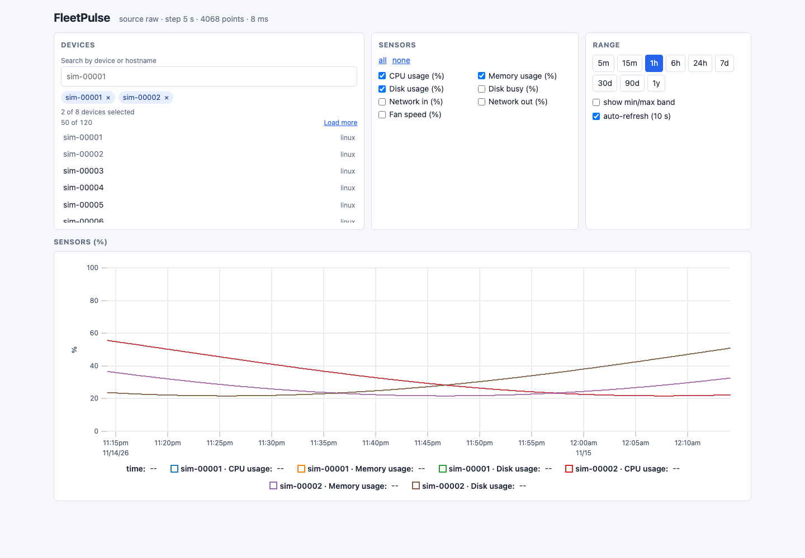

# Web UI

`cmd/query` serves one self-contained page at `/` (and `/index.html`). The page
is a single HTML file with no framework, no build tooling beyond the inliner,
and no requests to anything except the query API on its own origin.



The screenshot above was captured against a local mock implementing
[contract 04](../contracts/04-query-api.md), because the Docker Compose stack
(task T15) is not part of this task. The page and the requests it makes are the
same when served by `cmd/query`.

## Build

`web/index.src.html` is the human-edited source. It contains two marker lines:

```html
<!-- INLINE_UPLOT_JS -->
<!-- INLINE_UPLOT_CSS -->
```

`scripts/build_web.sh` (plain bash + awk, 23 lines) replaces each marker with the
matching file from `web/vendor/` and writes `web/index.html`. The output is
embedded in the query binary by `web/embed.go`.

```sh
make web
```

`make web` is idempotent: running it twice produces byte-identical output.
`web/index.html` is generated and committed, so a source change is not complete
until `make web` has been run.

`scripts/check_web.sh` fails if the generated file contains an `http://` or
`https://` URL outside a `/*! ... */` license comment. Pass a path to check a
different file (used by its negative test).

```sh
./scripts/check_web.sh
# ok: no external URLs in web/index.html
```

### Vendored uPlot

Only the chart library is vendored. It is pinned to **uPlot 1.6.32** (the 1.6.x
line requested by the task). Each vendored file starts with the upstream MIT
license plus a version note; the bytes after the 1177-byte header are exactly
the upstream release file.

| file | upstream source | upstream SHA-256 | vendored SHA-256 |
|------|-----------------|------------------|------------------|
| `web/vendor/uPlot.iife.min.js` | <https://unpkg.com/uplot@1.6.32/dist/uPlot.iife.min.js> | `19c8d4c6ad88929a79f4ae49d6f7161566dfd0ba3d15cc495e974f787eb78f1f` | `6df969a85ba1a068b993cf0e8f69d5d10508c6daf25e254e1c024b94afdedf21` |
| `web/vendor/uPlot.min.css` | <https://unpkg.com/uplot@1.6.32/dist/uPlot.min.css> | `df630c6a8d6f8eeaff264b50f73ce5b114f646ffd9a0bb74f049b0a00135fa04` | `a9e7f5f25e4c20b29edf74110a9aac99c94a2fc2987aad62b56b9c17dd5343d8` |

The vendored checksums include the license header. Generated `web/index.html`
was 84,960 bytes when this page was written, well under the 150 KB limit.

## Shareable state

The URL hash is read once on load and rewritten with `history.replaceState` on
every change:

```text
#devices=sim-00001,sim-00002&sensors=cpu_usage,memory_usage&range=1h
```

- `devices` is comma-separated; duplicates are removed and at most 8 are kept.
- `sensors` is comma-separated; unknown sensor ids are ignored.
- `range` must be one of the nine supported ranges, otherwise `1h` is used.
- With no hash, only `cpu_usage` is selected and the range is `1h`.

Reloading a copied URL restores the chips, checkboxes, active range button and
chart without any user interaction.

## Ranges and refresh

| range | window | auto-refresh default |
|-------|--------|----------------------|
| `5m` | 5 minutes | on |
| `15m` | 15 minutes | on |
| `1h` | 1 hour | on |
| `6h` | 6 hours | off |
| `24h` | 24 hours | off |
| `7d` | 7 days | off |
| `30d` | 30 days | off |
| `90d` | 90 days | off |
| `1y` | 365 days | off |

When auto-refresh is on, the page repeats the series request every 10 seconds.
It skips a tick while the previous request is still loading or while the tab is
hidden. The checkbox can still be toggled manually for any range.

## Manual checklist

Run through this list with the stack (or a mock implementing contract 04) before
merging a UI change. "Expected" describes the visible result.

### 1. Device search

- [ ] Type a partial device id or hostname (for example `sim`). After about
      250 ms the results list updates to matches from
      `GET /api/v1/devices?q=sim&limit=50&offset=0`. Typing quickly does not
      send one request per keystroke.
- [ ] Expected: the list shows device id, plus hostname/OS when they differ from
      the id. The counter above it reads `N of TOTAL`.
- [ ] Click a result. Expected: it becomes a chip, the result is disabled, the
      chart requests that device, and the hash contains it.
- [ ] Click the `×` on a chip. Expected: the chip disappears, the device is no
      longer highlighted as selected, the chart refreshes, and the hash drops it.
- [ ] If `N < TOTAL`, click **Load more**. Expected: another 50 devices are
      appended and the counter grows; the button disappears at the end.
- [ ] Add eight devices and try a ninth. Expected: the hint reads
      `maximum of 8 devices reached` and no ninth chip is added.

### 2. Sensors

- [ ] On a fresh URL with no hash, the sensors panel contains the seven sensors
      from `GET /api/v1/sensors`, and only **CPU usage** is checked.
- [ ] Expected: the chart draws CPU for each selected device.
- [ ] Click **all**. Expected: all seven boxes are checked and the chart requests
      seven sensors per device (unless that would exceed 24 series).
- [ ] Click **none**. Expected: no box is checked, the chart is replaced by
      `select at least one sensor`, and the status line reads
      `no sensors selected`.
- [ ] Toggle one box. Expected: the matching line appears or disappears, and the
      hash `sensors=` list changes.

### 3. Range

- [ ] Load the page without a hash. Expected: **1h** is the pressed button and
      the request uses `range=1h`.
- [ ] Click each of `5m 15m 1h 6h 24h 7d 30d 90d 1y`. Expected: the pressed
      button moves, the chart reloads for that window, and the hash `range=`
      matches. A range shorter than the previous one should visibly zoom in.
- [ ] Expected: auto-refresh turns on for `5m`, `15m`, `1h` and off for the rest
      (see section 5).

### 4. Chart

- [ ] Select two devices and three sensors. Expected: one uPlot chart, one time
      x-axis, and a single y-axis fixed at `0` to `100` labelled `%`. There is
      one coloured line per selected (device, sensor) pair (at most 24).
- [ ] Expected: the legend lists every line; clicking a legend entry hides or
      shows that line without a new request.
- [ ] Move the pointer across the plot. Expected: a tooltip appears near the
      cursor with the bucket time and the value of every visible series at that
      time, formatted like `42.17 %`.
- [ ] Select a sensor whose series has empty buckets. Expected: the line breaks
      at those buckets instead of connecting across them or drawing zero.
- [ ] Check **show min/max band**. Expected: a translucent band appears behind
      each visible line using the `min`/`max` values from the API, and the
      tooltip values gain a `(min–max)` suffix. Unchecking removes both.
- [ ] Uncheck the band on a fresh load. Expected: it is off by default.

### 5. Live refresh

- [ ] Load `range=1h`. Expected: **auto-refresh (10 s)** is checked. Watch the
      network panel; a new `GET /api/v1/series` request fires every 10 seconds
      and the status line's point count/time updates.
- [ ] Click `6h`. Expected: auto-refresh becomes unchecked and no periodic
      request is sent. Click `1h` again; it should become checked again.
- [ ] Check auto-refresh manually on `6h`. Expected: refresh starts anyway.
- [ ] Leave the tab in the background. Expected: the page does not issue refresh
      requests until it is visible again.

### 6. Status line, errors, loading, no data

- [ ] While a request is in flight. Expected: the header status reads
      `loading…`; the previous chart stays visible.
- [ ] After a successful request. Expected: the status line contains
      `source <tier> · step <n> s · <n> points · <n> ms`, where the last number
      is measured by the browser around `fetch`.
- [ ] Request a range with no stored rows. Expected: the chart area reads
      `no data` and the status line starts with `no data`.
- [ ] Make the API fail (stop the query service, or use a mock that returns an
      error). Expected: a red banner shows `code: message` from the contract-04
      error body, and the status line reads `request failed · <n> ms`. The
      banner clears on the next successful request.
- [ ] Select more than 24 device × sensor pairs. Expected: the chart is replaced
      by `too many series`, the banner explains the limit, and no series request
      is sent.

### 7. Shareable state

- [ ] Select devices, sensors and a range. Expected: the address bar hash updates
      immediately, without adding history entries, e.g.
      `#devices=sim-00001,sim-00002&sensors=cpu_usage,memory_usage&range=6h`.
- [ ] Copy that URL into a new tab and reload. Expected: the same chips,
      checkboxes, pressed range button, band checkbox and chart are restored.
- [ ] Load `#devices=nope&sensors=nope&range=99y`. Expected: the unknown device
      stays as a chip (devices are not validated here), the unknown sensor is
      ignored, and the range falls back to `1h`.

### Constraints

- [ ] No external requests: `./scripts/check_web.sh` passes, and the browser
      network panel shows only same-origin `/api/v1/...` requests.
- [ ] No `eval`, `Function` constructor or `innerHTML` in the application
      script; all network strings reach the DOM through `textContent` or
      properties.
- [ ] `web/index.html` is at most 150 KB. `make web` twice yields identical
      bytes.
- [ ] The page is usable at a laptop width (about 1280–1440 px) and reflows to
      one column below 900 px.
- [ ] Current Chrome, Firefox and Safari: no console errors on load.

## Verification performed for this task

- `make web` run twice: identical `web/index.html`.
- `./scripts/check_web.sh`: `ok: no external URLs in web/index.html`.
- Feature checks driven through the Chrome DevTools Protocol against a local
  mock of contract 04: hash restore, debounced search, add/remove chips, load
  more (50 → 100 → 120), eight-device cap, sensors all/none, every range,
  auto-refresh on/off (and two series requests across an 11 s window), legend
  toggles, tooltip, min/max bands, no-data, error banner, and the 24-series
  guard.
- `make fmt`, `make test` and `make build` pass with the pinned Go 1.27.4
  toolchain; the task report covers the repository's pre-existing lint finding.
